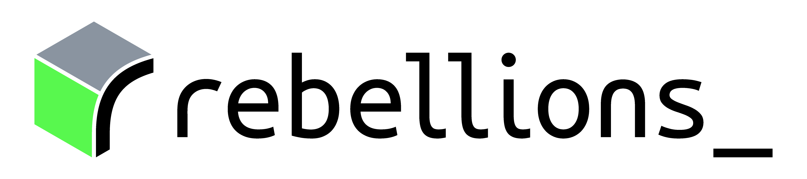

# Optimum RBLN

<div align="center">

<picture>
  <source media="(prefers-color-scheme: dark)" srcset="assets/rbln_logo_dark.png">
  
</picture>

[](https://badge.fury.io/py/optimum-rbln)
[](https://github.com/rbln-sw/optimum-rbln/blob/main/LICENSE)
[](https://docs.rbln.ai/software/optimum/optimum_rbln.html)
[](CODE_OF_CONDUCT.md)


</div>

🤗 Optimum RBLN provides an interface between HuggingFace libraries ([Transformers](https://huggingface.co/docs/transformers), [Diffusers](https://huggingface.co/docs/diffusers/index)) and RBLN NPUs, including [ATOM](https://rebellions.ai/rebellions-product/rbln-ca25/) and [Rebel100](https://rebellions.ai/rebellions-product/rebel/).

This library enables seamless integration between the HuggingFace ecosystem and RBLN NPUs through a comprehensive toolkit for model loading and inference across single and multi-NPU environments. While we maintain a list of [officially validated models and tasks](https://docs.rbln.ai/latest/software/optimum/index.html), users can easily adapt other models and tasks with minimal modifications.

## Key Features

🚀 **High Performance Inference**
- Optimized model execution on RBLN NPUs through RBLN SDK compilation
- Support for both single and multi-NPU inference
- Integrated with RBLN Runtime for optimal performance

🔧 **Easy Integration**
- Seamless compatibility with HuggingFace Model Hub
- Drop-in replacement for existing HuggingFace pipelines
- Minimal code changes required for NPU acceleration


## Seamless Replacement for Existing HuggingFace Code

Swap the HuggingFace class for its `RBLN` counterpart. Passing a HuggingFace model id compiles the
model for the NPU on the first run; passing a directory of previously compiled artifacts loads them
directly, so compilation is skipped.

```diff
- from diffusers import StableDiffusionXLPipeline
+ from optimum.rbln import RBLNStableDiffusionXLPipeline

# Load model
model_id = "stabilityai/stable-diffusion-xl-base-1.0"
prompt = "Astronaut in a jungle, cold color palette, muted colors, detailed, 8k"
- pipe = StableDiffusionXLPipeline.from_pretrained(model_id)
+ pipe = RBLNStableDiffusionXLPipeline.from_pretrained(model_id)

# Generate image
image = pipe(prompt).images[0]

# Save image result
image.save("image.png")

+ # (Optional) Save compiled artifacts to skip the compilation step in future runs
+ pipe.save_pretrained("compiled_sdxl")
```

## Compile Ahead of Time with the CLI

Instead of compiling inside your script, you can compile a model up front with the `optimum-rbln-cli`
command and load the resulting artifacts later:

```bash
# Compile and save the artifacts to ./compiled_qwen3
optimum-rbln-cli --model-id Qwen/Qwen3-4B -o ./compiled_qwen3 \
    --max_seq_len 8192 --batch_size 1 --num_devices 4
```

```python
from optimum.rbln import RBLNQwen3ForCausalLM

# Load the compiled artifacts (no recompilation)
model = RBLNQwen3ForCausalLM.from_pretrained("./compiled_qwen3")
```

Useful CLI helpers:

```bash
optimum-rbln-cli --list-classes                     # list available RBLN classes
optimum-rbln-cli --class RBLNQwen3ForCausalLM --show-rbln-config  # show accepted rbln_config keys
optimum-rbln-cli --examples                          # show more usage examples
```

## Caller-owned decoder KV cache

Decoder exports use torch-rbln device tensors for their caches. On x86-64, `uv sync` installs torch-rbln. The pinned torch-rbln release provides x86-64 wheels. Decoder export on AArch64 requires a compatible torch-rbln build. Install the matching rebel-compiler separately. Set `RBLN_DEVICE_MAP` before starting Python. For example, `RBLN_DEVICE_MAP='[8]'` makes physical NPU 8 available to torch as `rbln:0`. For tensor parallelism, map the whole group, for example `[12,13]`, and pass `rbln_device=[12, 13]` at load.

```python
import torch
from optimum.rbln import RBLNLlamaForCausalLM

RBLNLlamaForCausalLM.from_model(
    hf_model,
    model_save_dir="compiled-llama",
    rbln_config={
        "npu": "RBLN-CA25",
        "create_runtimes": False,
        "attn_impl": "flash_attn",
        "max_seq_len": 4096,
        "kvcache_partition_len": 1024,
        "batch_size": 2,
    },
)
model = RBLNLlamaForCausalLM.from_pretrained("compiled-llama", rbln_device=8)
cache = model.get_kv_cache()
replacement = {name: torch.zeros_like(tensor) for name, tensor in cache.items()}
model.set_kv_cache(replacement)
```

This path was tested with torch-rbln 0.12.1a1 and rebel-compiler 0.12.1.dev816+g24590902.prod. For offline CA25 export, start the compile process with `RBLN_DUMMY_DEVICE=1 RBLN_FORCE_NPU_NAME=RBLN-CA25` and use a separate process for inference.

Prefill and every decode batch size share the bound tensors. Each cache input requires a distinct contiguous allocation. Bind the tensors between requests, after any outstanding execution finishes. Page tables and sequence positions belong to the request and must agree with the cache contents. A caller can bind its tensors before the first forward or call to `get_kv_cache()`.

An explicit `kvcache_num_blocks` compiles a fixed shape. Automatic sizing with flash attention compiles a variable block dimension for full attention. The estimate uses each cache input's physical placement and the allocator's segment sizes on each chiplet. `--set-kvcache-num-blocks` and `--set-memory-budget` can change the saved block count of these artifacts. Their compiled binaries are reusable. To size against current device usage, pass e.g. `rbln_runtime_memory_budget="90%"` at load. This caps total usage per NPU, including the loaded runtimes. It requires driver support for per-chiplet memory statistics. When attaching an already materialized cache, use the matching saved block count and omit live sizing, which counts those tensors as occupied memory.

## Documentation

Check out [the documentation of Optimum RBLN](https://docs.rbln.ai/latest/software/optimum/index.html) for more advanced usage.

## Getting Started

> **Note:** The `rebel-compiler` library, which is required for running `optimum-rbln`, is only available for approved users. Please refer to the [installation guide](https://docs.rbln.ai/getting_started/installation_guide.html) for instructions on accessing and installing `rebel-compiler`.

### Install from PyPI

To install the latest release of this package:
```bash
pip install optimum-rbln --extra-index-url https://download.pytorch.org/whl/cpu
```

### Install from source

#### Prerequisites

- Install [uv](https://docs.astral.sh/uv/) (refer to [this link](https://docs.astral.sh/uv/getting-started/installation/) for detailed commands)

The below commands create a virtual environment in `.venv` and install `optimum-rbln` in editable mode along with its dependencies. See [CONTRIBUTING.md](CONTRIBUTING.md) for the full development setup.

```bash
git clone https://github.com/rbln-sw/optimum-rbln.git
cd optimum-rbln
uv sync
```

### Need Help?

- Join discussions and get answers in our [Developer Community](https://discuss.rebellions.ai/)
- Contact maintainers at [support@rebellions.ai](mailto:support@rebellions.ai)
